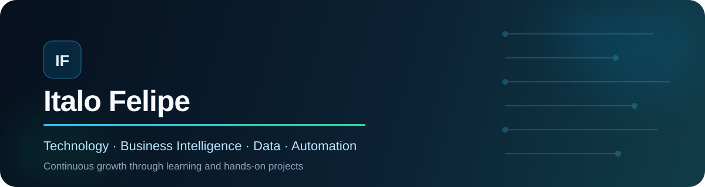

A technology professional committed to continuous growth and to building useful,
reliable, and scalable solutions.

## About me

I am a technology professional driven by continuous learning and by the challenge of
turning real-world problems into simple, reliable, and useful solutions. I bring a
strong **Business Intelligence** background, combining business context, data
modeling, KPIs, dashboards, and performance analysis to turn information into clear
and actionable insights.

My technical foundation connects **Python**, **SQL**, data, automation, and process
knowledge to reduce manual work and create more reliable information flows. I learn
by building and am currently expanding my knowledge of **AWS**, **PySpark**, and
engineering fundamentals through hands-on projects. My goal is to keep broadening my
technical perspective and contribute wherever technology and business need to work
together.

## What I deliver

| | Outcome | How I create value |
| :---: | --- | --- |
| 📊 | **Business Intelligence** | I turn business needs and raw data into data models, KPIs, dashboards, and actionable insights. |
| 📈 | **Performance visibility** | I build clear reporting experiences that help teams monitor results, identify trends, and make informed decisions. |
| ⚙️ | **Process automation** | I use Python and SQL to remove repetitive work, connect information, and reduce manual errors. |
| 🗄️ | **Reliable, well-structured data** | I design queries, models, and validations that make data consistent and reusable. |
| 🤝 | **Business and technology alignment** | I translate needs into objective solutions and communicate results clearly across teams. |
| 🧪 | **Quality-driven delivery** | I value automated tests, version control, documentation, and continuous code improvement. |

## Skills and toolkit

### Applied in projects and day-to-day work

`Business Intelligence` · `Data Modeling` · `Dashboards` · `KPIs` · `Performance Analysis` · `Management Reporting` · `Data Storytelling`

### Currently learning and applying progressively

`S3` · `Lambda` · `Glue` · `Athena` · `EC2` · `PySpark` · `Serverless` · `SQS/SNS` · `Kafka` · `LocalStack` · `Observability`

## Featured projects

| Project | Outcome | Engineering highlights |
| --- | --- | --- |
| **[XML to JSON Converter](https://github.com/italofelipe01/xml_json_converter)** | Converts XML and Brazilian electronic invoices into structured JSON, individually or in batches. | Python, CLI, validation, unit tests, and CI |
| **[Weather Data Pipeline](https://github.com/italofelipe01/weather-data-pipeline)** | Collects, transforms, validates, and serves weather data for analysis. | PostgreSQL, dbt, Airflow, Great Expectations, Superset, and Docker |
| **[Network Stability Monitor](https://github.com/italofelipe01/teste_rede)** | Monitors network routes, latency, and outages with real-time visualization. | Python, parallel processing, web dashboard, and historical metrics |

> These projects are also my hands-on lab for progressively applying AWS, distributed
> processing, and event-driven architecture with clear documentation.

## GitHub activity

  
  

